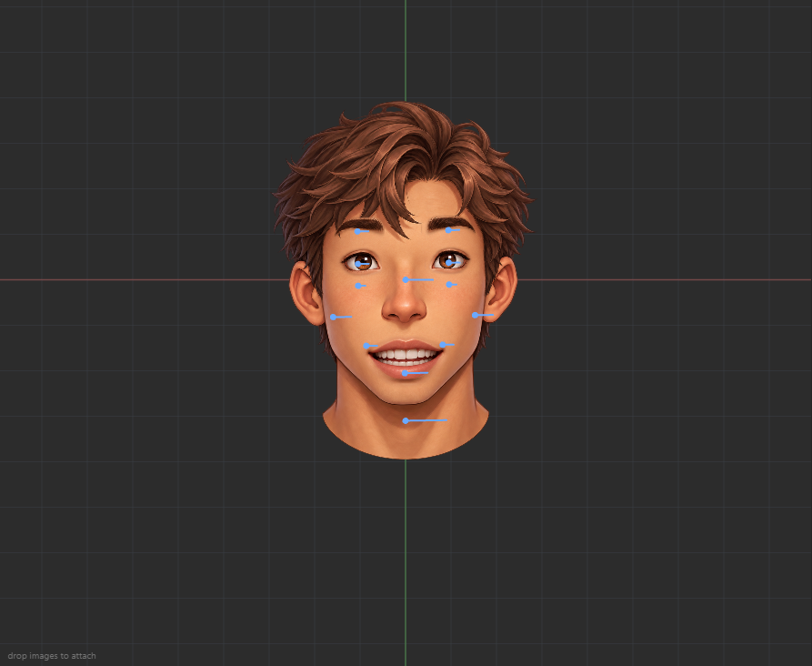
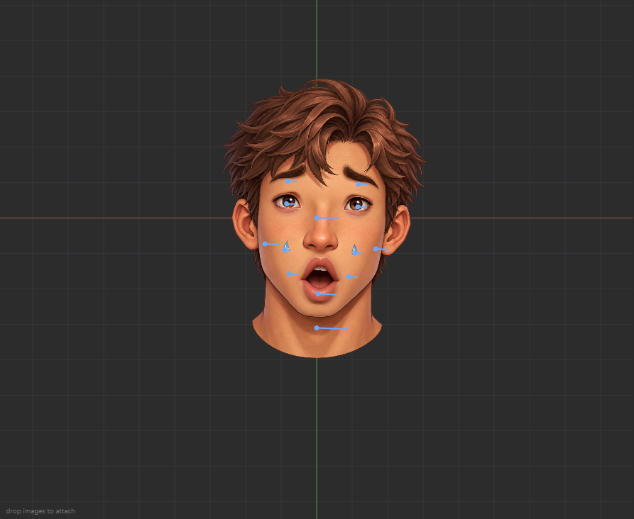
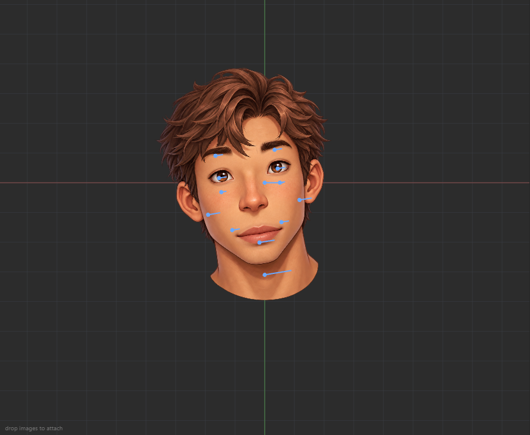
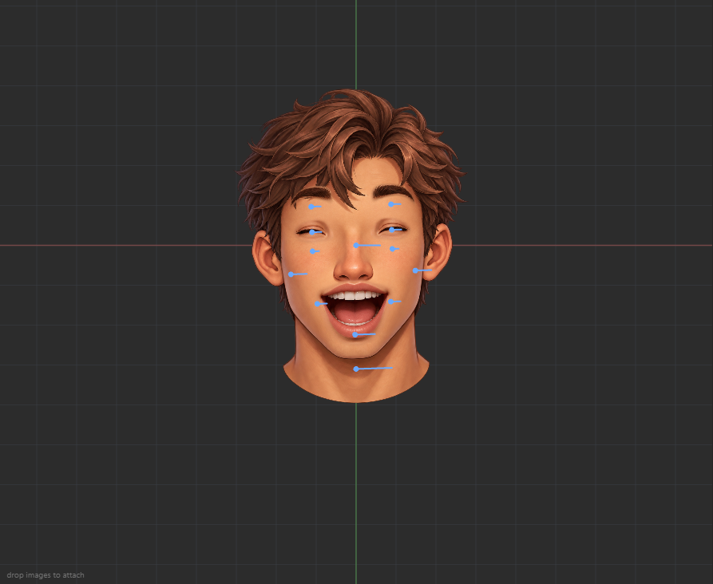

# Practical facial performance sample

Open `Face-Performance.bbbproj` in BoneByBone. It is self-contained: both generated transparent PNGs are embedded. Choose **Animate**, select a clip, and press Play.

| Clip      | Duration | Facial acting                                                                             |
| --------- | -------- | ----------------------------------------------------------------------------------------- |
| Talking   | 4 s      | Timed AH/EE/OH/OO/FV/MBP mouth shapes, jaw opening, blinks and brow emphasis.             |
| Crying    | 5 s      | Sad moist eyes and brows, downturned weighted lip corners, sobbing jaw and falling tears. |
| Head Tilt | 4 s      | Eased turns and holds about the neck, weighted neck bending and a blink.                  |
| Laughing  | 4 s      | Smile into open laughter, repeated jaw pulses, squinted eyes and raised cheeks.           |

This is a silent facial acting example; Talking demonstrates a viseme sequence, rather than synchronization to a supplied voice recording. The art is shaded, stylized realism and front facing. The four expressions use actual artwork changes and localized weighted deformation.

[Watch all four native animations](previews/Facial-Performances.webm). This clean preview is recorded from the exported Web runtime, without editor bone gizmos. `record-preview.mjs` reproduces it after running verification, using the development server.

The rig has 13 bones, 8 separately editable layers and 25 mesh attachments. The base face blends Head/Neck/Jaw/Cheeks. Mouth shapes blend Head/Jaw/Lip corners; eye and brow layers blend Head with their expression controls. These weights visibly matter in all four clips: removing them changes geometry by 9–61 rig units. No Deform keys substitute for weighting.

To edit weights, select the Face or Mouth slot, choose **Weights**, then choose a bound bone. Direct mode selects vertices and adjusts their weight with a vertical drag or the exact slider. Ctrl/Cmd adds vertices; Add, Remove and Replace paint with size, strength and feather. Locks preserve a bone's contribution. Weight edits also work during animation playback.

`base.png` and `features.png` are unmodified Image Generation results. [Exact prompts](generation-prompts.md) record their creation. `build-project.mjs` builds the UV meshes and tracks; `verify-project.mjs` validates source round trip, original PNG bytes and 2,040 editor/native frames with zero vertex error. `preview.mjs` renders representative frames in the actual editor. Run these scripts from the repository root after `npm install`; preview requires a running editor at `SPRINE_URL` (default port 5196).

Numeric evidence is in `validation.json`; actual browser evidence is in `browser-validation.json` and `previews/`. Unity integration remains on hold.
